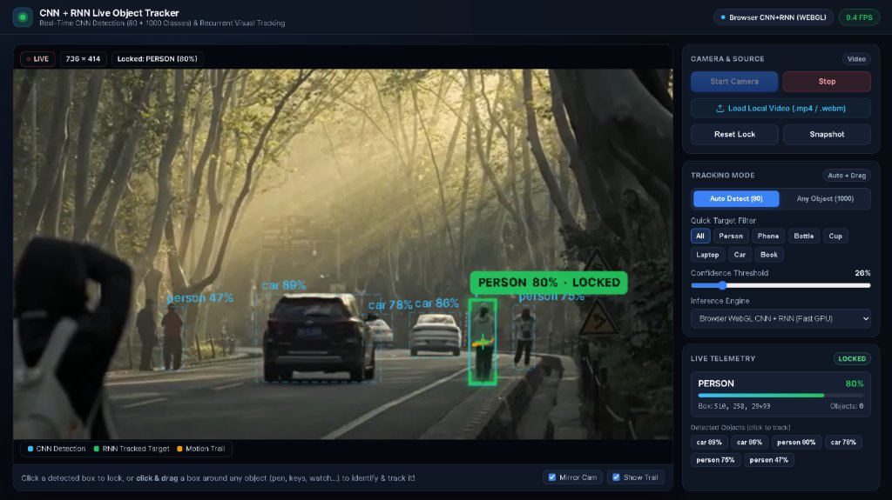
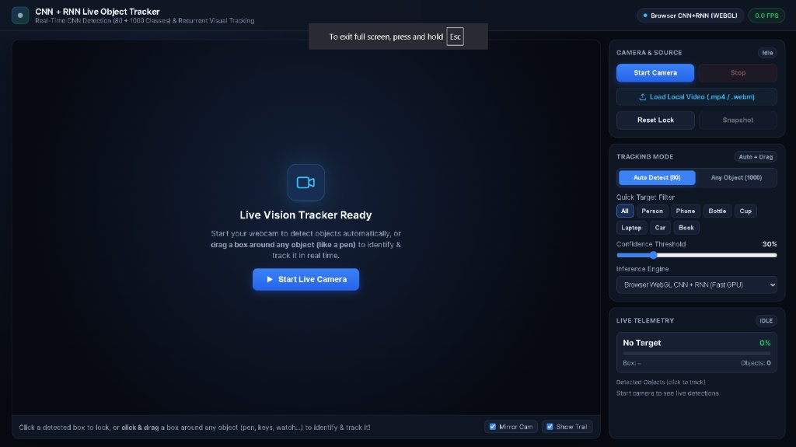

# Visual Object Tracking using CNN and RNN (ROLO)

[](https://www.python.org/)
[](https://pytorch.org/)
[](https://github.com/ultralytics/ultralytics)
[](https://opencv.org/)
[](https://www.tensorflow.org/js)

A modernized, high-performance **Visual Object Tracking (VOT)** system combining **Convolutional Neural Networks (CNN)** for spatial feature representation and **Stacked Long Short-Term Memory (LSTM)** recurrent networks for temporal motion modeling and occlusion handling, based on the **ROLO (Recurrent YOLO)** architecture.

> [!NOTE]
> **Lineage & Enhancement Notice**: This project is a modernized, refactored, and significantly enhanced version of the original CNN+RNN tracker created by **[Mayuri Deshpande (@mayuri0192)](https://github.com/mayuri0192/Object-Tracking-using-CNN-and-RNN)**.
> 
> **Key Enhancements in this Version**:
> - **Python 3.12 & PyTorch Modernization**: Migrated legacy Python 2 / TensorFlow 1.x code to PyTorch 2.x and Python 3.12 with clean modular design.
> - **YOLOv8 CNN Backbone**: Integrated Ultralytics YOLOv8 for high-fidelity visual feature extraction and precise proposal boxes.
> - **Interactive Live Web App**: Added a real-time web application with WebGL GPU acceleration and server-side streaming.
> - **Novel "Any Object" Drag-to-Track**: Added real-time classification (1,000 ImageNet categories via MobileNet) and template-matching tracking for unconstrained targets.
> - **Clean Architecture**: Modularized into reusable `src/` packages, streamlined training/testing pipelines, and automated slide presentation generation.

---

## 📸 Live Web Dashboard & Telemetry

### Real-Time Video Object Detection & Recurrent Tracking

*Real-time multi-object detection (blue boxes), recurrent locked target tracking (green box), motion trajectory trail (gold crosshair), and live telemetry dashboard.*

### Interactive Vision Tracker UI

*Live web stage supporting webcam streaming, local video upload (`.mp4`/`.webm`), quick category filtering, confidence adjustment, and real-time telemetry.*

---

## 🌟 Key Features

- **Spatio-Temporal Fusion (ROLO)**: Fuses high-dimensional CNN visual features (4096-D) with spatial bounding box coordinates (6-D) into a unified 4102-D representation per frame.
- **Occlusion Resilience**: The 3-layer stacked LSTM network maintains a recurrent velocity vector ($h_t$) and trajectory memory ($c_t$), enabling continuous tracking even when targets are temporarily occluded by obstacles.
- **Dual Inference Engines**:
  - **Browser WebGL Engine**: Ultra-low-latency in-browser GPU acceleration via TensorFlow.js (MobileNetV2-SSD + Recurrent 6-step Tracker).
  - **Python Backend Engine**: Full PyTorch Stacked LSTM Tracker + Ultralytics YOLOv8 backbone via high-throughput HTTP streaming.
- **Dual Tracking Modes**:
  - **Auto Detect Mode**: Detects and tracks 80 standard COCO object classes (person, car, bottle, laptop, phone, etc.).
  - **Custom Drag-to-Track Mode**: Click and drag a box around *any* novel object (pen, keys, mug, notebook) to classify it across 1,000 ImageNet categories and track its visual trajectory.
- **Trajectory Smoothing**: Replaces erratic frame-by-frame detector jumping with smooth, continuous motion interpolation and golden motion trail visualization.

---

## 📁 Clean Project Structure

```text
Object-Tracking-using-CNN-and-RNN/
├── src/                          # Core Deep Learning Modules
│   ├── model.py                  # PyTorch CNN + 3-Layer Stacked LSTM Tracker
│   ├── feature_extractor.py      # YOLOv8 CNN backbone feature extractor (4102-D)
│   └── utils.py                  # Bounding box, IoU, metrics & helper functions
│
├── train.py                      # Step 1: Train the Stacked LSTM tracker on sequences
├── test.py                       # Step 2: Evaluate model & compute IoU/MSE metrics
├── track.py                      # Step 3: Run standalone tracker on any video or webcam
├── extract.py                    # Utility: Pre-extract 4102-D CNN features from datasets
├── app.py                        # Step 4: Full-stack live webcam/video tracking web server
│
├── web/                          # Frontend Web UI (HTML5, CSS3, ES6 JavaScript)
│   ├── index.html                # Modern responsive tracking dashboard
│   ├── styles.css                # Dark neon aesthetic interface
│   └── app.js                    # WebGL engine, tracker logic, & telemetry handling
│
├── weights/                      # Model checkpoints
│   ├── tracker_model.pt          # Trained CNN+RNN Stacked LSTM weights
│   └── yolov8n.pt                # YOLOv8 Nano CNN backbone detector
│
├── data/                         # Datasets & Sequences
│   └── sample_frames/            # Test sequence frames (22.jpg - 36.jpg)
│
├── docs/                         # Documentation assets & UI screenshots
│   └── images/                   # Dashboard and live tracking previews
│
├── presentation/                 # Presentation deck (.pptx, diagrams, speaker notes)
│   ├── Visual Object Tracking model.pptx
│   ├── diagrams/                 # 8 high-resolution architecture diagrams
│   └── presentation_notes.md     # Slide-by-slide speaker script
│
├── requirements.txt              # Python package dependencies
├── .gitignore                    # Environment & artifact exclusions
└── README.md                     # Project documentation
```

---

## 🚀 Quickstart Guide

### 1. Environment Setup

Clone the repository and activate the virtual environment:

```powershell
git clone https://github.com/TarunSajikumar/VOT.git
cd VOT

# Create and activate virtual environment (Windows)
python -m venv .venv
.\.venv\Scripts\Activate.ps1

# Install dependencies
pip install -r requirements.txt
```

### 2. Launch the Live Web App

Start the interactive tracking application:

```powershell
python app.py --port 5000
```

Open **[http://localhost:5000](http://localhost:5000)** in your browser:
- Click **Start Camera** to begin tracking via your webcam, or click **Load Local Video** to upload an `.mp4` file.
- Click any detected box to lock onto a target, or **click & drag** around any item to track custom objects!

---

## 🔬 Training & Evaluation Pipeline

### Step 1: Feature Extraction
Extract 4102-dimensional spatio-temporal feature vectors from video sequence folders:
```powershell
# Extract features for all sequences in data/
python extract.py --all

# Or extract from a video file into a sequence folder:
python extract.py --video "path/to/video.mp4" --sequence MySequence
```

### Step 2: Train the Stacked LSTM Tracker
Train the recurrent model on sequence datasets:
```powershell
python train.py --sequences Car4 David3 --epochs 100 --batch-size 16 --lr 0.001
```

### Step 3: Quantitative Testing & IoU Evaluation
Evaluate tracking accuracy, Mean Squared Error, and IoU:
```powershell
python test.py --sequence David3 --save-video --show
```

### Step 4: Standalone Video / Webcam Tracking
Run inference directly via OpenCV:
```powershell
# Track on an MP4 video file
python track.py --source "path/to/video.mp4" --output results/tracked.mp4 --show

# Run directly on live webcam (ID: 0)
python track.py --source 0 --show
```

---

## 📊 Model Architecture

```text
Input Video Sequence (6 Frames)
       │
       ▼
┌───────────────────────────────┐
│   YOLOv8 CNN Backbone (SPPF)   │
└──────────────┬────────────────┘
               ├───────────────────────────────────────────┐
               ▼                                           ▼
   4096-D Visual Feature Vector               6-D Bounding Box [cls, cx, cy, w, h, conf]
               │                                           │
               ▼                                           │
┌───────────────────────────────┐                          │
│ Visual Linear Projection(128) │                          │
└──────────────┬────────────────┘                          │
               └───────────────────────┬───────────────────┘
                                       ▼
                       Multi-Modal Fusion Layer (166-D)
                                       │
                                       ▼
                       ┌───────────────────────────────┐
                       │  3-Layer Stacked LSTM (128-D) │  ◄── Recurrent Memory State
                       └──────────────┬────────────────┘
                                       │
                                       ▼
                       ┌───────────────────────────────┐
                       │ Linear Head + Sigmoid Layer   │
                       └──────────────┬────────────────┘
                                       │
                                       ▼
                         Normalized [cx, cy, w, h]
```

---

## 📚 References & Acknowledgments

- **Original Base Model & Author**: **Mayuri Deshpande** ([@mayuri0192](https://github.com/mayuri0192)) — original repository: [Object-Tracking-using-CNN-and-RNN](https://github.com/mayuri0192/Object-Tracking-using-CNN-and-RNN). Sincere credit and appreciation to Mayuri for the foundational architecture that inspired this enhanced project!
- **ROLO Paper**: Ning, Guanghan, et al. *"Spatially Supervised Recurrent Convolutional Neural Networks for Visual Object Tracking."* [arXiv:1607.05781](https://arxiv.org/abs/1607.05781).
- **YOLO Paper**: Redmon, Joseph, et al. *"You Only Look Once: Unified, Real-Time Object Detection."* [arXiv:1506.02640](https://arxiv.org/abs/1506.02640).
- **Ultralytics YOLOv8**: [https://github.com/ultralytics/ultralytics](https://github.com/ultralytics/ultralytics).
